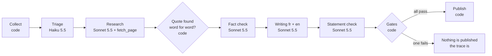

# ai/watch · veille/ia

**Live: https://ai-watch.bassemfayed.com/en/** (English) · https://ai-watch.bassemfayed.com (French)

A daily AI briefing written, verified and published every morning by a pipeline of models, with no human review. Every published sentence is tied to a quote found word for word in its source, and everything the pipeline refuses to publish is shown with the reason it was refused.

The project is a harness engineering showcase: what matters here is not the model, but what the code around it allows it to do, checks behind it, and records.

## What a run does



1. **Collect** (code). Reads the RSS and Atom feeds listed in [`sources.json`](sources.json), keeps only `https` links to allowlisted domains, and drops anything already seen.
2. **Triage** (Haiku 5.5). Scores the items. The code keeps at most six topics, with a per-source cap so that no single source writes the whole edition.
3. **Research** (Sonnet 5.5, one agent per topic). An agent loop with a single tool, `fetch_page`. The model chooses what to read; the code decides what it may read: only the domains of the topic's own source (and, on shared hosts, only allowed paths), no redirect to another host, at most 3 pages and 6 turns. Every tool call is recorded. The agent returns atomic facts, each with an exact quote and the page it comes from.
4. **Quote gate** (code). A quote must appear word for word in a page the agent actually read during its loop. Otherwise the fact is dropped.
5. **Fact check** (Sonnet 5.5, fresh context). Judges each fact against its quote alone, in both languages. A refused fact never reaches the writer.
6. **Writing** (Sonnet 5.5). Writes the edition in French and English from validated facts only. It never sees the web.
7. **Statement check** (Sonnet 5.5). Judges each written sentence against the facts it cites. It gets the same context as the writer (source and title of each topic) and does not re-judge facts that were already validated.
8. **Gates and publishing** (code). Verifier threshold (at least half of the statements validated), volume, budget. Only statements validated one by one are published, and the edition title is built from their titles. If a gate fails, no content is written. The run trace is always written.

Three rules hold it together:

- the model that reads the web cannot write anything;
- the model that writes never reads the web;
- only code publishes.

## What it guarantees, and what it does not

| Guaranteed by code | Not guaranteed |
|---|---|
| Every published sentence cites at least one fact | That the source is right: an allowlisted page that is wrong will be quoted faithfully |
| Every cited fact has a quote present word for word in a page that was read | That an edition comes out every day: the pipeline prefers to publish nothing |
| A missing verdict counts as a refusal | Full independence of the verifier: it shares its model with the writer; only the context and the instructions differ |
| A run exceeds its budget by at most one call | Editorial quality: no test measures it |

The source list is therefore the real safeguard, and it is maintained by hand.

## The site

Astro, fully static. It only reads files from the repository and re-validates them at build time with the same schemas as the pipeline: invalid data breaks the build, so nothing gets deployed.

| Page | Content |
|---|---|
| `/` | today's edition, each item set next to the quotes that prove it |
| `/state/` | the state of the art: at most three points added per run, never rewritten |
| `/radar/` | recommendations in four rings, each move sourced |
| `/pipeline/` | the stages with the last run's figures, run history, the eval, refusals |
| `/runs/<date>/` | one run's trace: gates, tool calls, model calls, rejections |

The same pages exist under `/en/`. Content is generated in both languages and verified in both. A run trace contains no sentences, only codes and numbers, translated at display time by [`site/src/lib/i18n.ts`](site/src/lib/i18n.ts).

## Architecture

The dependency rule, without ceremony: business rules know nothing about the network, files or the SDK.

| File | Role | I/O |
|---|---|---|
| [`pipeline/schema.ts`](pipeline/schema.ts) | data shapes, rejection reason and gate codes | no |
| [`pipeline/gates.ts`](pipeline/gates.ts) | word-for-word quotes, publishable statements | no |
| [`pipeline/decide.ts`](pipeline/decide.ts) | topic selection, what gets published from a draft and the verdicts | no |
| [`pipeline/loop.ts`](pipeline/loop.ts) | the agent loop: turns, tool errors returned to the model, cap, trace | no |
| [`pipeline/tools.ts`](pipeline/tools.ts) | the `fetch_page` tool and its limits | through an injected function |
| [`pipeline/run.ts`](pipeline/run.ts) | stage orchestration, reading and writing files | yes |
| [`pipeline/agents.ts`](pipeline/agents.ts) | the `Llm` port and its Anthropic API adapter | yes |
| [`pipeline/cli.ts`](pipeline/cli.ts) | a second `Llm` adapter: the `claude` CLI, no API key needed | yes |
| [`pipeline/collect.ts`](pipeline/collect.ts) | feeds and web pages, allowlist | yes |
| [`pipeline/prompts/`](pipeline/prompts) | one set of instructions per role (in French) | |

The rest of the repository:

| Folder | Content |
|---|---|
| `content/` | editions, radar, state of the art (written by the pipeline) |
| `runs/` | one trace per day (always written) |
| `data/seen.json` | items already processed |
| `evals/` | trap facts for the verifier, and the latest result |
| `site/` | the Astro site |
| `tdd/`, `.claude/` | the gate and the agents of the TDD cycle |

## Test-driven development

Every behaviour goes through a red, green, refactor cycle. The `/tdd` command in Claude Code runs it with one agent per phase:

| Phase | Agent | Gate ([`tdd/gate.sh`](tdd/gate.sh)) | Commit |
|---|---|---|---|
| Red | `tdd-red` writes tests | only `*.test.ts` files changed and the suite fails | `test(...)` |
| Green | `tdd-green` writes the minimal code | no test changed, suite and types pass | `feat(...)` |
| Refactor | `tdd-refactor` restructures, or does nothing | no test changed, suite and types pass | `refactor(...)` |

An agent sees only the files, not the previous agent's reasoning, and the script decides whether a phase may be committed. Small changes follow the same cycle by hand, through the same gate. The git history shows the cycles.

Over 220 tests, all offline: models and the network are replaced by test doubles. They cover the rules and the orchestration, not the prompts; those are judged by the eval and by real runs.

## Commands

Node 24 or later (TypeScript runs directly, without a build step).

| Command | Effect | Calls a model |
|---|---|---|
| `npm test` | the whole suite | no |
| `npm run typecheck` | types | no |
| `npm run pipeline -- --collect-only` | reads the real feeds, lists new items | no |
| `npm run pipeline -- --dry-run` | full run, writes nothing, prints the trace and the edition | yes |
| `npm run pipeline -- --replay` | like `--dry-run`, but also re-reads items already seen | yes |
| `npm run pipeline` | full run, writes `content/`, `runs/`, `data/` | yes |
| `npm run evals` | sends the trap facts to the real verifier, writes `evals/last.json` | yes |
| `npm run build` | builds the site into `site/dist` | no |

Two ways to call the models:

- `ANTHROPIC_API_KEY`: the Anthropic API, with native tool calling. This is what the GitHub workflow uses.
- `LLM_BACKEND=cli` before the command: the `claude` CLI signed in to a subscription, for example `LLM_BACKEND=cli npm run pipeline`. The researcher's tool loop is emulated in JSON in this mode.

`RUN_BUDGET_USD` caps a run (2 USD by default).

## Tuning the pipeline

A source in [`sources.json`](sources.json):

```json
{ "id": "claude-code", "name": "Claude Code (releases)", "feed": "https://github.com/anthropics/claude-code/releases.atom", "domains": ["github.com"], "paths": ["/anthropics/claude-code/"], "maxPicks": 1 }
```

| Field | Role |
|---|---|
| `feed` | RSS or Atom feed |
| `domains` | domains the pipeline may read for this source; the agent studying a topic can only read its own source's domains |
| `paths` | allowed path prefixes on those domains, for shared hosts such as github.com (optional) |
| `max` | items read from the feed (40 by default) |
| `maxPicks` | maximum topics per run (2 by default, 1 for commentary blogs) |

Before adding a source, check with `--collect-only` that its feed is readable and that its pages do not block bots.

## Deployment

- **Daily run**: [`.github/workflows/daily.yml`](.github/workflows/daily.yml), at 04:17 UTC (GitHub guarantees neither the exact time of scheduled runs nor that they happen). It runs the tests, then the pipeline, then commits `content/`, `runs/` and `data/`. It needs the `ANTHROPIC_API_KEY` secret; without it, the run is skipped. The manual trigger offers a "replay" checkbox for a trial that publishes nothing.
- **Evals**: [`.github/workflows/evals.yml`](.github/workflows/evals.yml), on every pull request that touches the pipeline.
- **Site**: Cloudflare Pages, project `ai-watch-by-bf` connected to the repository. Build command `npm run build`, output directory `site/dist` (also set in [`wrangler.jsonc`](wrangler.jsonc)). Every push to `main` redeploys, including the daily run's commits.

## Cost

A full run through the API costs between 0.30 and 0.40 USD, based on the real runs of 14 October 2026, so roughly ten dollars a month. `RUN_BUDGET_USD` caps it. The figure shown on the site is computed by the pipeline from token counts and a price table in `pipeline/agents.ts`: it is an estimate, and the invoice is what counts. Hosting and GitHub Actions are free for this repository.

## Known limitations

- The verifier threshold was lowered from 70% to 50% after several real runs in which the gate rejected whole editions over a few refused statements. Every statement is still checked one by one; only the overall threshold moved.
- The writer and the verifier use the same model: the verifier is independent through its context and instructions, not through its model.
- Text is extracted from pages with regular expressions: a page rendered in JavaScript yields little text, and its quotes are rejected.
- Some primary sources are missing because they have no readable feed or their pages block bots.

## Author

[Bassem Fayed](https://bassemfayed.com/) · [GitHub](https://github.com/BassemFd) · [LinkedIn](https://www.linkedin.com/in/bassem-fd/) · [bassem.fayed@gmail.com](mailto:bassem.fayed@gmail.com)
