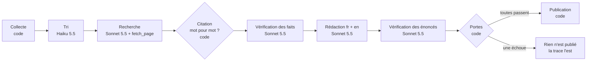

# veille/ia · ai/watch

**En ligne : https://ai-watch-by-bf.pages.dev** (français) · https://ai-watch-by-bf.pages.dev/en/ (English)

Un site de veille sur l'IA écrit, vérifié et publié chaque matin par un pipeline de modèles, sans relecture humaine. Chaque phrase publiée renvoie à une citation retrouvée mot pour mot dans sa source, et tout ce que le pipeline refuse de publier est affiché avec la raison du refus.

> *A daily AI briefing written, verified and published by a pipeline of models with no human review. Every published sentence is tied to a quote found word for word in its source, and everything the pipeline refuses to publish is shown with the reason. The site is bilingual; this README is in French.*

Le projet sert de démonstration d'ingénierie de harness : ce qui compte ici n'est pas le modèle, mais ce que le code autour l'autorise à faire, vérifie derrière lui et trace.

## Ce que fait un run



1. **Collecte** (code). Lit les flux RSS et Atom de [`sources.json`](sources.json), ne garde que les liens `https` vers les domaines de la liste blanche, écarte ce qui a déjà été vu.
2. **Tri** (Haiku 5.5). Note les items. Le code retient au plus six sujets, avec un plafond par source pour qu'aucune n'écrive toute l'édition.
3. **Recherche** (Sonnet 5.5, un agent par sujet). Une boucle d'agent avec un seul outil, `fetch_page`. Le modèle choisit ce qu'il lit ; le code décide ce qu'il a le droit de lire : liste blanche, pas de redirection vers un autre hôte, 3 pages et 6 tours au plus. Chaque appel d'outil est tracé. L'agent rend des faits atomiques, chacun avec une citation exacte et la page d'où elle vient.
4. **Porte des citations** (code). Une citation doit figurer mot pour mot dans une page que l'agent a réellement lue pendant sa boucle. Sinon le fait disparaît.
5. **Vérification des faits** (Sonnet 5.5, contexte neuf). Juge chaque fait contre sa seule citation, dans les deux langues. Un fait refusé n'atteint jamais le rédacteur.
6. **Rédaction** (Sonnet 5.5). Écrit l'édition en français et en anglais à partir des seuls faits validés. Il ne voit jamais le web.
7. **Vérification des énoncés** (Sonnet 5.5). Juge chaque phrase rédigée contre les faits qu'elle cite.
8. **Portes et publication** (code). Seuil du vérificateur, volume, budget. Une porte échoue et aucun contenu n'est écrit. La trace du run, elle, est toujours écrite.

Trois règles tiennent l'ensemble :

- le modèle qui lit le web ne peut rien écrire ;
- le modèle qui écrit ne lit pas le web ;
- seul le code publie.

## Ce que ça garantit, et ce que ça ne garantit pas

| Garanti par le code | Non garanti |
|---|---|
| Toute phrase publiée cite au moins un fait | Que la source dit vrai : une page de la liste blanche qui se trompe sera citée fidèlement |
| Tout fait cité a une citation présente mot pour mot dans une page lue | Qu'une édition sort chaque jour : le pipeline préfère ne rien publier |
| Un verdict manquant vaut un refus | L'indépendance totale du vérificateur : il partage son modèle avec le rédacteur, seuls le contexte et la consigne diffèrent |
| Un run ne dépasse pas son budget de plus d'un appel | La qualité éditoriale : aucun test ne la mesure |

La liste des sources est donc le vrai rempart, et elle est tenue à la main.

## Le site

Astro, entièrement statique. Il ne lit que des fichiers du dépôt et les revalide au build avec les mêmes schémas que le pipeline : une donnée invalide casse le build, donc rien n'est déployé.

| Page | Contenu |
|---|---|
| `/` | l'édition du jour, chaque brève posée à côté des citations qui la prouvent |
| `/state/` | l'état de l'art : au plus trois points ajoutés par run, jamais réécrits |
| `/radar/` | les recommandations en quatre anneaux, chaque mouvement sourcé |
| `/pipeline/` | les étapes avec les chiffres du dernier run, l'historique, l'éval, les refus |
| `/runs/<date>/` | la trace d'un run : portes, appels d'outils, appels aux modèles, rejets |

Les mêmes pages existent sous `/en/`. Le contenu est généré dans les deux langues et vérifié dans les deux. La trace d'un run ne contient aucune phrase, seulement des codes et des chiffres, traduits à l'affichage par [`site/src/lib/i18n.ts`](site/src/lib/i18n.ts).

## Architecture

Règle de dépendance, sans cérémonie : les règles métier ne connaissent ni le réseau, ni les fichiers, ni le SDK.

| Fichier | Rôle | E/S |
|---|---|---|
| [`pipeline/schema.ts`](pipeline/schema.ts) | formes des données, codes des raisons de rejet et des portes | non |
| [`pipeline/gates.ts`](pipeline/gates.ts) | citation mot pour mot, énoncé publiable | non |
| [`pipeline/decide.ts`](pipeline/decide.ts) | choix des sujets, ce qui est publié à partir d'un brouillon et des verdicts | non |
| [`pipeline/loop.ts`](pipeline/loop.ts) | la boucle d'agent : tours, erreurs d'outil rendues au modèle, plafond, trace | non |
| [`pipeline/tools.ts`](pipeline/tools.ts) | l'outil `fetch_page` et ses limites | via une fonction injectée |
| [`pipeline/run.ts`](pipeline/run.ts) | orchestration des étapes, lecture et écriture des fichiers | oui |
| [`pipeline/agents.ts`](pipeline/agents.ts) | le port `Llm` et son adaptateur API Anthropic | oui |
| [`pipeline/cli.ts`](pipeline/cli.ts) | second adaptateur du port `Llm` : le CLI `claude`, sans clé API | oui |
| [`pipeline/collect.ts`](pipeline/collect.ts) | flux et pages web, liste blanche | oui |
| [`pipeline/prompts/`](pipeline/prompts) | une consigne par rôle | |

Le reste du dépôt :

| Dossier | Contenu |
|---|---|
| `content/` | éditions, radar, état de l'art (écrits par le pipeline) |
| `runs/` | une trace par jour (toujours écrite) |
| `data/seen.json` | les items déjà traités |
| `evals/` | faits piégés pour le vérificateur, et le dernier résultat |
| `site/` | le site Astro |
| `tdd/`, `.claude/` | la porte et les agents du cycle TDD |

## Développement en TDD

Chaque comportement passe par un cycle red, green, refactor. La commande `/tdd` de Claude Code le déroule avec un agent par phase :

| Phase | Agent | Porte ([`tdd/gate.sh`](tdd/gate.sh)) | Commit |
|---|---|---|---|
| Red | `tdd-red` écrit des tests | seuls des `*.test.ts` ont changé et la suite échoue | `test(...)` |
| Green | `tdd-green` écrit le code minimal | aucun test modifié, suite et types verts | `feat(...)` |
| Refactor | `tdd-refactor` restructure, ou ne fait rien | aucun test modifié, suite et types verts | `refactor(...)` |

Un agent ne voit que les fichiers, pas le raisonnement du précédent, et c'est le script qui décide si la phase est commitée. Les petits changements suivent le même cycle à la main, avec la même porte. L'historique git montre les cycles.

222 tests, tous hors ligne : les modèles et le réseau y sont remplacés par des doublures. Ils couvrent les règles et l'orchestration, pas les consignes ; celles-ci sont jugées par l'éval et par les runs réels.

## Commandes

Node 24 ou plus (le TypeScript est exécuté directement, sans compilation).

| Commande | Effet | Appelle un modèle |
|---|---|---|
| `npm test` | toute la suite | non |
| `npm run typecheck` | types | non |
| `npm run pipeline -- --collect-only` | lit les vrais flux, liste les items nouveaux | non |
| `npm run pipeline -- --dry-run` | run complet, n'écrit rien, affiche la trace et l'édition | oui |
| `npm run pipeline -- --replay` | comme `--dry-run`, mais relit aussi les items déjà vus | oui |
| `npm run pipeline` | run complet, écrit `content/`, `runs/`, `data/` | oui |
| `npm run evals` | soumet les faits piégés au vrai vérificateur, écrit `evals/last.json` | oui |
| `npm run build` | construit le site dans `site/dist` | non |

Deux façons d'appeler les modèles :

- `ANTHROPIC_API_KEY` : l'API Anthropic, avec appel d'outil natif. C'est ce qu'utilise le workflow GitHub.
- `LLM_BACKEND=cli` devant la commande : le CLI `claude` connecté à un abonnement, par exemple `LLM_BACKEND=cli npm run pipeline`. La boucle d'outils du chercheur y est émulée en JSON.

`RUN_BUDGET_USD` plafonne un run (2 $ par défaut).

## Régler le pipeline

Une source dans [`sources.json`](sources.json) :

```json
{ "id": "mistral", "name": "Mistral AI", "feed": "https://mistral.ai/rss.xml", "domains": ["mistral.ai"], "max": 40, "maxPicks": 2 }
```

| Champ | Rôle |
|---|---|
| `feed` | flux RSS ou Atom |
| `domains` | domaines que le pipeline a le droit de lire pour cette source ; l'union de tous forme la liste blanche de `fetch_page` |
| `max` | items lus dans le flux (40 par défaut) |
| `maxPicks` | sujets au plus par run (2 par défaut, 1 pour les blogs de commentaire) |

Avant d'ajouter une source, vérifier avec `--collect-only` que son flux est lisible et que ses pages ne bloquent pas les robots.

## Mise en ligne

- **Run quotidien** : [`.github/workflows/daily.yml`](.github/workflows/daily.yml), à 4 h UTC. Il lance les tests, puis le pipeline, puis committe `content/`, `runs/` et `data/`. Il a besoin du secret `ANTHROPIC_API_KEY` ; sans lui, le run est sauté. Le déclenchement manuel propose une case « replay » pour un essai qui ne publie rien.
- **Évals** : [`.github/workflows/evals.yml`](.github/workflows/evals.yml), sur chaque pull request qui touche le pipeline.
- **Site** : Cloudflare Pages, projet `ai-watch-by-bf` relié au dépôt. Commande de build `npm run build`, dossier de sortie `site/dist` (repris dans [`wrangler.jsonc`](wrangler.jsonc)). Chaque push sur `main` redéploie, y compris les commits du run quotidien.

## Coût

Un run complet par l'API a coûté environ 0,27 $ lors du premier essai réel, avec la rédaction encore sur un modèle plus cher. Le chiffre affiché sur le site est calculé par le pipeline à partir des tokens et d'une grille de prix écrite dans `pipeline/agents.ts` : c'est une estimation, la facture fait foi. L'hébergement et GitHub Actions sont gratuits pour ce dépôt.

## Limites connues

- Le seuil du vérificateur (70 % d'énoncés validés) a été posé a priori ; avec peu d'énoncés, deux refus suffisent à rejeter une édition.
- L'extraction de texte des pages se fait par expressions régulières : une page rendue en JavaScript donne peu de texte et ses citations sont rejetées.
- Certaines sources primaires manquent faute de flux lisible ou parce que leurs pages bloquent les robots.

## Auteur

[Bassem Fayed](https://career-log.bassem-fayed.workers.dev/) · [GitHub](https://github.com/BassemFd) · [LinkedIn](https://www.linkedin.com/in/bassem-fd/)
